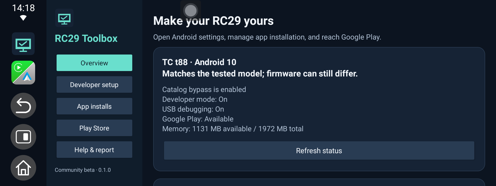

# RC29 Toolbox 0.1.2 beta

A small community Android app for LAMTTO RC29 / TC t88 owners. It brings the hidden Settings route, catalog controls, Google Play access, and a shareable device report into one interface. Java + XML; no third-party runtime dependencies, native libraries, ads, analytics, internet permission, root commands, or background services.

This is a community beta, not an official LAMTTO, Google, or SiriusXM product. The code is supplied for inspection and rebuilding. Redistribution permission for third-party apps or firmware is not implied; none is bundled here.



## Download

[Download the complete RC29 Toolbox beta ZIP](https://github.com/LTGRaven/rc29-toolbox/releases/download/v0.1.2-beta/RC29-Toolbox-0.1.2-beta.zip). Extract it before copying APKs onto a microSD card or USB drive. The release includes the standard APK, temporary Bootstrap APK, optional legacy Starter APK, Windows helper, source archive, instructions, and test results. [View all release files](https://github.com/LTGRaven/rc29-toolbox/releases/tag/v0.1.2-beta).

The standard APK was installed and tested on the reference RC29. The Bootstrap package identity is a hardcoded exception in the inspected July firmware, but the new Bootstrap APK still needs confirmation on another factory-locked unit. Read the edition and setup instructions below before installing.

## Start with the right APK

**RC29-Toolbox.apk** (`com.rc29.toolbox`) is the normal edition. Use it if APK installation already works or if USB debugging is already available.

**RC29-Toolbox-Bootstrap.apk** (`com.github.metacubex.clash.meta`) is the preferred temporary helper for a catalog-locked RC29. Inspection of the July firmware found this package name in the installer's hardcoded exception list. The APK contains only Toolbox code and uses Toolbox's signing key; it contains no Clash Meta code or signature and is not an update for that app. Remove it after the standard Toolbox is installed.

**RC29-Toolbox-Starter.apk** (`com.sirius`) is the older fallback. It works only on units where that package already has an individual approval. Reports now confirm that approval is not present on every RC29, even with the same firmware label. It contains no SiriusXM code or signature and is not a SiriusXM update.

Android will reject either temporary edition if a genuine or differently signed app already uses its package name. Do not uninstall an existing app or erase its data merely to make room for Toolbox; use the other route or the authorized-PC route instead.

## Route A: start on the RC29

1. If apps already install, use the standard APK. If the RC29 rejects it, copy **RC29-Toolbox-Bootstrap.apk** to a USB drive or SD card and open it with Package Installer.
2. Open the Bootstrap, choose **App installs → Allow all app installs**, and wait for the property verification. Then retry **RC29-Toolbox.apk**.
3. Open the standard Toolbox and remove the temporary Bootstrap. Add the Play Store shortcut from the standard edition so it remains afterward.
4. If the Bootstrap installs but cannot change the property, open **Developer setup → Open Android Storage**. Tap the large used-storage number/title eight times without leaving the screen. If a vendor password screen opens, press Back; the tested firmware enabled Developer Options before opening that screen. Enable USB debugging and use the Windows helper below.
5. In **Play Store**, open the already-installed store. Toolbox does not download Google Play, install Google services, create an account, or sign you in.

On the tested firmware direct catalog changes worked without enabling USB debugging first. The Storage guide and USB debugging remain available for the PC fallback. Opening Toolbox alone does not change the catalog or debugging settings.

## Route B: Windows helper

1. Enable USB debugging through the Storage/Developer Options route above, connect a data-capable USB cable, and accept your computer's authorization on the RC29.
2. Extract the entire release ZIP into a folder. Download Google's [Android Platform Tools](https://developer.android.com/tools/releases/platform-tools) if needed. Put the extracted `platform-tools` folder beside `Start-Windows.cmd`. The helper can also find Android Studio's default SDK installation or `adb.exe` on PATH.
3. Open **Start-Windows.cmd** and choose **Install/open standard Toolbox**. If needed, this grants an individual catalog exception to Toolbox only. It does not silently enable the master bypass.
4. Choose **Allow all app installs** in the app, or option 2 in the Windows helper. Option 3 restores the catalog restriction.

On some earlier T88 firmware, including reports from `T88-MIPI91-USER-20260331174849`, the master bypass property can read as enabled while Package Installer and Google Play remain restricted. The updated Windows helper therefore grants the standard Toolbox package its own approval before every installation attempt. After Toolbox is installed, use option 4 to approve other package IDs individually when the master bypass is not honored.

With several Android devices connected, the helper asks which one to use. It shows the device model and asks before changing an unverified model. Administrator privileges are not required. The launcher uses a process-local PowerShell execution-policy setting; it does not change Windows' saved execution policy.

For macOS/Linux or manual use, run these commands with Android Platform Tools and one authorized device connected:

```text
adb shell settings --user 0 put system com.rc29.toolbox 1
adb install -r RC29-Toolbox.apk
adb shell setprop persist.sys.tc.allow.third.install 1
adb shell getprop persist.sys.tc.allow.third.install
```

The final command should return `1`. Use `adb -s SERIAL` if several devices are connected. The manual examples assume Android user 0; the Windows helper detects the active user.

## Individual approvals and undo

Individual approvals require an authorized PC on the tested firmware. Use option 4 in the Windows helper, or enter a package name in Toolbox to display the matching manual command. Merely displaying a command makes no change.

The Windows helper displays the previous value before changing it. Save that value if you want to undo the approval. If it was `null`, use the displayed delete command; otherwise restore the saved value. An approval is for the package identity; it does not authenticate the developer or download/install that app. The standard Toolbox installer also preserves its own package approval after a successful installation so firmware that ignores the master bypass does not immediately block updates.

## What the catalog control changes

The tested firmware checks `persist.sys.tc.allow.third.install` inside `PackageInstallerSession.assertApkConsistentLocked` in `services.jar`. When enabled, that vendor catalog check is skipped for all sources. Ordinary Android checks, Play Protect, device/app compatibility, storage requirements, and signature matching are not disabled by Toolbox.

To restore the restriction, use the app's **Restore catalog restriction** button or:

```text
adb shell setprop persist.sys.tc.allow.third.install 0
```

Existing apps and individual approvals remain. **Uninstalling Toolbox does not undo the property change.** This is a persistent property; reboot/update persistence has not been separately verified on every firmware.

## Supported/tested environment

- TC t88 / LAMTTO RC29, Android 10 / API 29.
- Firmware label: `T88-MIPI91-USER-20260727172621`.
- Fingerprint: `alps/Android/Android:10/QP1A.191105.004/826:user/dev-keys`.
- This unit's SELinux mode was already **Permissive**. Toolbox neither changes SELinux nor requests root. A device with an enforcing or differently configured policy may deny direct property changes; use the authorized PC fallback if supported.
- All APKs use minSdk 21 and targetSdk 35. Supporting an Android API level does not establish firmware compatibility.
- Other manufacturers, RC29 revisions, and firmware releases require separate testing. The model indicator is not a firmware certification.

The ordinary user cannot usually write arbitrary system properties on standard Android. The direct route is specific to this firmware's permissions. See [Android's system-property access-control documentation](https://source.android.com/docs/core/architecture/configuration/add-system-properties).

## Privacy and permissions

The app requests no Android permissions. No permissions are needed for its catalog command attempt, Settings shortcuts, or Play Store entry on the tested device. It declares no internet, storage, accessibility, device-administrator, or settings permission. It has no remote-command interface: only the main Activity and optional Play Store launcher alias are exported.

Reports are generated locally, previewed, and shared only through the user's chosen share destination. Reports include build/model/setup information, not serial numbers, account names, Wi-Fi names, or full logs. The app does not export firmware/APKs.

## Send a device report

Open **Help & report → Preview device report → Copy** in Toolbox. [Open a device report](https://github.com/LTGRaven/rc29-toolbox/issues/new?template=device-report.md) and paste the report. Include your firmware label and what worked or failed. You can attach a photo of the report if copying from the RC29 is inconvenient.

Reports are not sent automatically. GitHub issues are public, so review pasted text and photos before submitting them. Do not include passwords, account details, or device serial numbers.

## Development

This project was developed with assistance from OpenAI's Codex. Codex helped inspect the device's firmware behavior, implement the Java/XML app and Windows helper, and verify the working installation controls on the owner's physical RC29. See `TEST-RESULTS.md` for the tested behavior and remaining limitations.

## Build and source

Use JDK 17 or newer and Android SDK 35. Open the source project in Android Studio, or run:

```text
gradlew.bat :app:assembleStandardDebug :app:assembleBootstrapDebug :app:assembleStarterDebug
```

On macOS/Linux use `sh gradlew`. Output APKs are under the corresponding folders in `app/build/outputs/apk/`. The first build needs internet access for Gradle and Android build tools if they are not already installed/cached.

Release builds use environment variables `RC29_SIGNING_STORE` and `RC29_SIGNING_PASSWORD`, alias `rc29-toolbox`. The distributed release APKs are signed and non-debuggable. Private signing keys and passwords are deliberately excluded from the source and release ZIPs. A build signed with your own key cannot update the supplied APK in place.

See `TEST-RESULTS.md` for the concrete verification performed for this beta, and `SHA256SUMS.txt` in the release download for artifact hashes.
